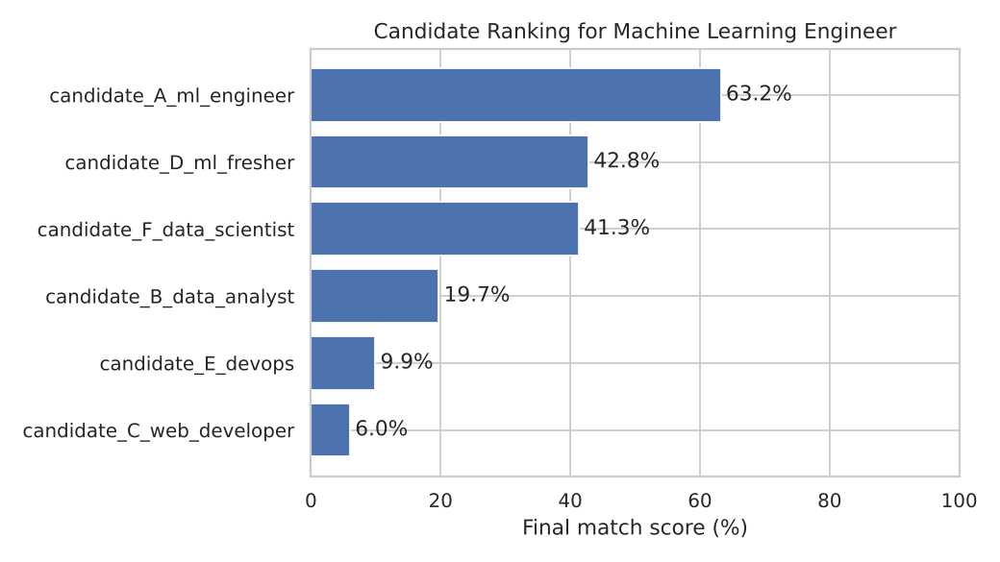

# 📄 AI Resume Screening System

An NLP-based tool that ranks resumes against a job description. It uses **TF-IDF** and **cosine similarity** for text matching, plus **skill matching** to show which required skills each candidate has and which are missing. A Streamlit web app lets recruiters upload PDF, DOCX or TXT resumes and get a ranked shortlist in seconds.

## How it works

1. **Text extraction:** reads PDF, DOCX and TXT resumes (`src/parser.py`).
2. **Preprocessing:** lowercasing, removing emails, URLs and special characters, tokenization, stopword removal and lemmatization with NLTK (`src/preprocess.py`).
3. **Vectorization:** TF-IDF with unigrams and bigrams over the job description and all resumes.
4. **Similarity:** cosine similarity between the job description and each resume.
5. **Skill matching:** finds required skills in the job description (from `data/skills.txt`) and reports matched and missing skills per candidate.
6. **Ranking:** `Final Score = 0.5 × text similarity + 0.5 × skill coverage` (the weight is adjustable in the app).

## Example output

Sample resumes ranked against a Machine Learning Engineer job description:

| Rank | Candidate | Final Score | Text Similarity | Skill Coverage |
|---|---|---|---|---|
| 1 | ML Engineer | 63.2% | 36.4% | 90% |
| 2 | ML Fresher | 42.8% | 20.6% | 65% |
| 3 | Data Scientist | 41.3% | 22.5% | 60% |
| 4 | Data Analyst | 19.7% | 9.5% | 30% |
| 5 | DevOps Engineer | 9.9% | 4.8% | 15% |
| 6 | Web Developer | 6.0% | 2.0% | 10% |



The sample resumes in `data/sample_resumes/` are fictional and written for demonstration.

## Project structure

```
├── app/app.py                 # Streamlit web app
├── src/
│   ├── parser.py              # PDF / DOCX / TXT text extraction
│   ├── preprocess.py          # cleaning, tokenization, stopwords, lemmatization
│   ├── screener.py            # TF-IDF, cosine similarity, skill matching, ranking
│   └── run_demo.py            # ranks the sample resumes and saves a chart
├── data/
│   ├── skills.txt             # master skill list (edit to add your own)
│   ├── job_description.txt    # sample job description
│   └── sample_resumes/        # fictional sample resumes
├── tests/test_screener.py     # unit tests
└── requirements.txt
```

## Run it locally

```bash
git clone https://github.com/SaiSirisha45/ai-resume-screening-system.git
cd ai-resume-screening-system
pip install -r requirements.txt

streamlit run app/app.py     # launch the web app
python -m src.run_demo       # rank the sample resumes from the command line
python -m pytest             # run the tests
```

In the app, tick **Use sample resumes and job description** for a quick demo, or paste your own job description and upload resumes.

## Tech stack

Python, Scikit-learn, NLTK, Pandas, Streamlit, PyPDF, python-docx, Matplotlib, Seaborn

## Future improvements

- Semantic matching with sentence embeddings or LLMs
- Extraction of experience years and education level
- Bias checks and anonymised screening

## Author

**Sai Sirisha Dakkata**: [GitHub](https://github.com/SaiSirisha45) | [LinkedIn](https://www.linkedin.com/in/dakkata-sai-sirisha-93811a2b2)
